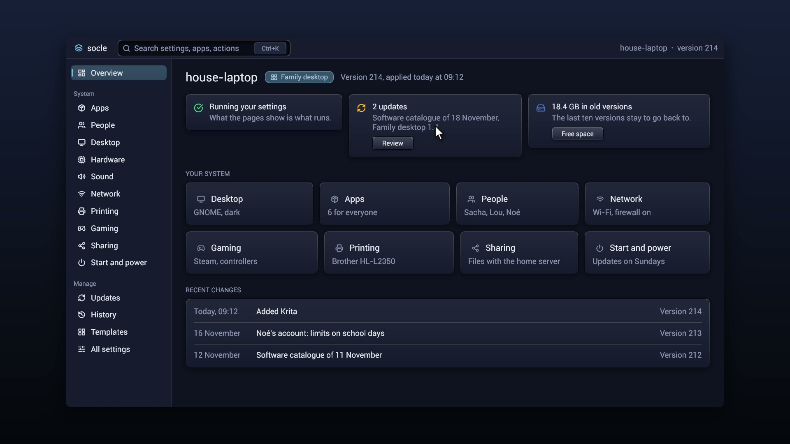

<h1 align="center">socle</h1>

<b>Your whole system in one window: start from a ready-made system, change any setting, go back in one step.</b>

socle installs a computer from a template (a family desktop, a gaming machine, a developer's workstation, a home
server), then runs it: apps, users, desktop, hardware, services and updates, each on a page of plain settings. Every
change is reviewed before it applies, and every earlier state stays one click away. Make a template of your own
system, extend someone else's, and share it.

Under the hood, socle owns a NixOS configuration, or a Home Manager configuration on any other system with Nix. It
writes data, never Nix code, so the configuration stays a plain flake: you can read it, keep it in git, and build it
without socle. socle's live images boot into its installer and install a NixOS with sane defaults: Determinate Nix,
nh, nix-output-monitor.

One small native program, written in [Odin](https://odin-lang.org) on
[gui_toolkit](https://github.com/sachahjkl/gui_toolkit).

## Status

In development. The window runs on a demo system: it drives no Nix yet. [ROADMAP.md](ROADMAP.md) gives the plan,
[src/md](src/md/README.md) the design, [docs/mockups](docs/mockups/README.md) the first sketches of the screens.

## Build

[docs/development.md](docs/development.md).

## License

MIT.
